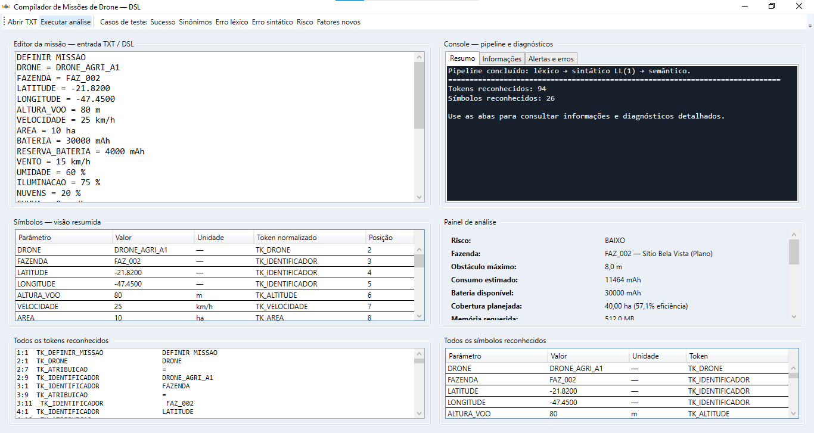
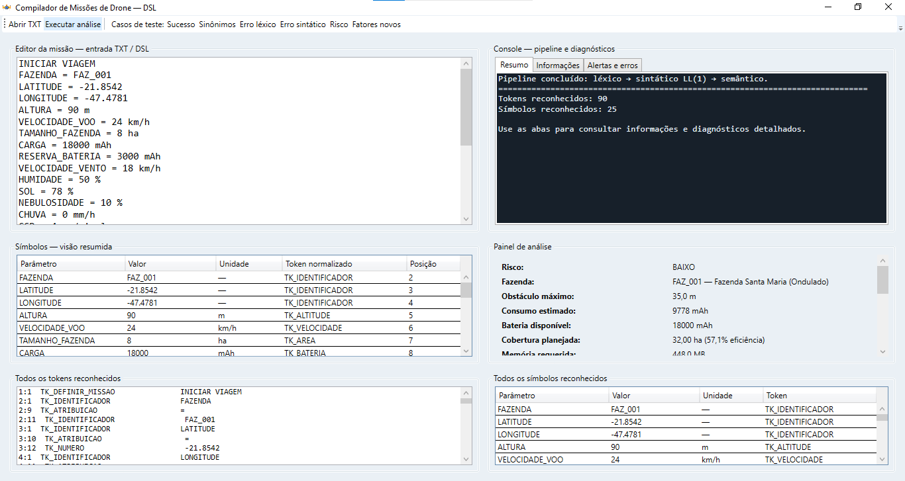
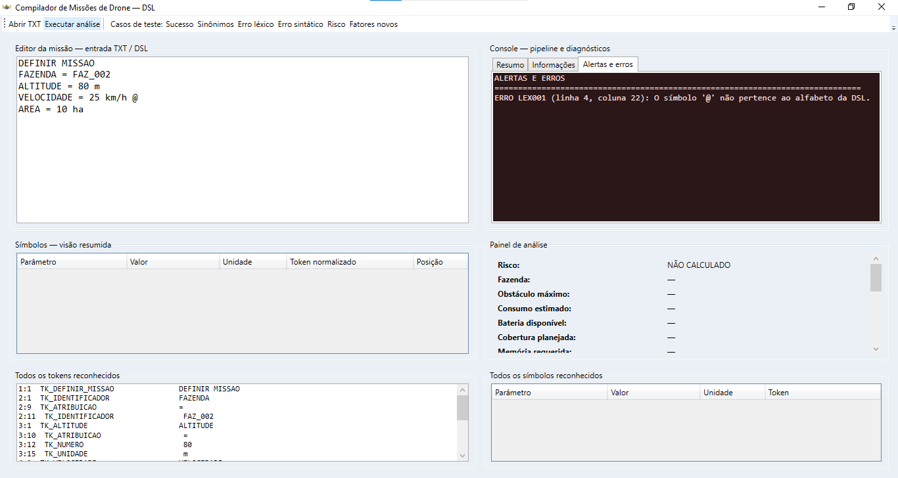
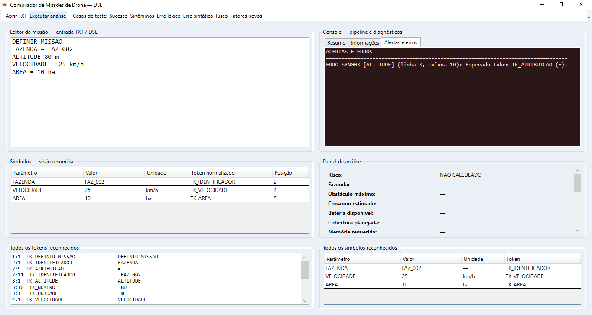
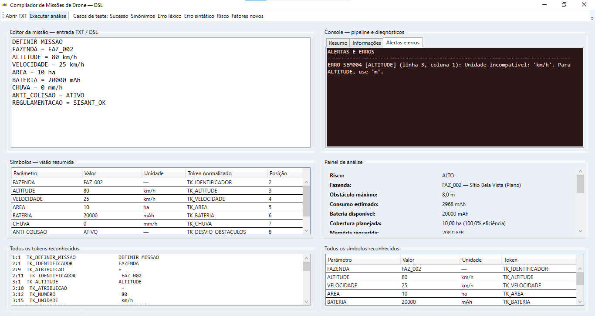
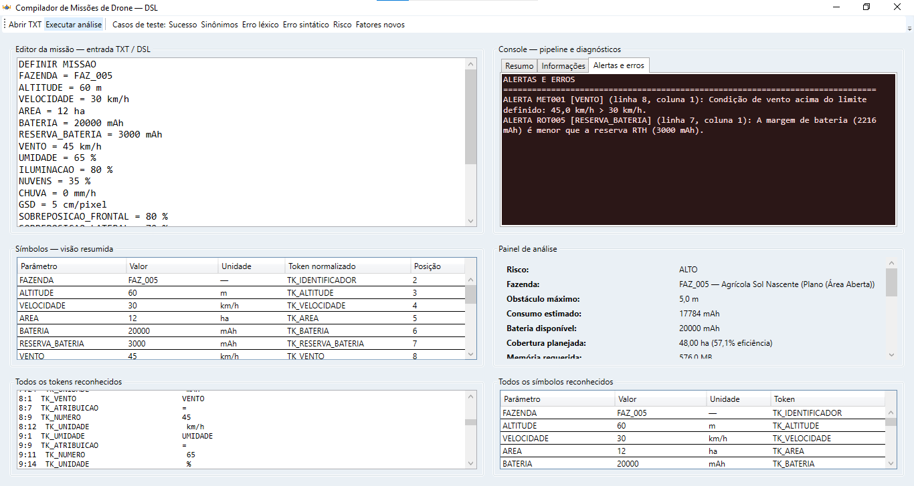

# Compilador de Missões de Drone - DSL agrícola

Aplicação acadêmica desenvolvida em **C# e WPF** para analisar arquivos TXT que descrevem missões de drones agrícolas. O projeto implementa um pequeno compilador com análise **léxica, sintática e semântica**, além de consultas a bases JSON de fazendas e de modelos de drones.

## Visão geral

O usuário informa uma missão em um arquivo TXT com parâmetros como fazenda, altitude, velocidade, área, bateria, condições meteorológicas, sensor e modelo de drone. A aplicação processa esse arquivo em fases:

```text
Arquivo TXT
    ↓
Lexer — caracteres → tokens
    ↓
Parser LL(1) — tokens → missão estruturada
    ↓
SemanticAnalyzer — regras, cálculos e compatibilidade
    ↓
RelatorioMissao
    ↓
Interface WPF — console, tokens, símbolos, métricas e diagnósticos
```

## Funcionalidades

- Definição formal do alfabeto da DSL.
- Reconhecimento de identificadores, números, unidades, status e palavras reservadas.
- Normalização de sinônimos, como `ALTURA` → `ALTITUDE` e `CAMERA` → `SENSOR`.
- Identificação de erros léxicos com linha e coluna.
- Parser descendente recursivo baseado em uma gramática LL(1).
- Identificação de erros sintáticos e recuperação por sincronização.
- Validação semântica de unidades, faixas, valores positivos e parâmetros duplicados.
- Consulta a fazendas fictícias com coordenadas, relevo e obstáculos.
- Cálculo didático de rota, cobertura, consumo de bateria e memória.
- Avaliação de vento, umidade, chuva, nuvens e iluminação.
- Verificação de RTH, VLOS/BVLOS, Terrain Following, regulamentação e anticolisão.
- Seleção de modelo por meio do comando `DRONE = ...`.
- Verificação de compatibilidade entre missão e perfil técnico do drone.
- Interface WPF com editor, console separado por categorias, tabela de símbolos e painel de análise.
- Exemplos de sucesso, sinônimos, erros léxicos, erros sintáticos, erros semânticos, autonomia, meteorologia, risco e incompatibilidade técnica.

## Interface e exemplos

### Missão completa



### Missão com sinônimos



### Diagnóstico de erro léxico



### Diagnóstico de erro sintático



### Diagnóstico de erro semântico



### Alerta meteorológico



## Requisitos

- Windows 10 ou superior.
- Visual Studio 2022 ou posterior, com o workload **Desktop development with .NET**; ou .NET SDK compatível com o alvo do projeto.
- .NET 10 para o projeto atual.
- Suporte a aplicações WPF.

O projeto utiliza `net10.0-windows` e possui `EnableWindowsTargeting` habilitado para permitir a compilação em ambientes compatíveis, mas a execução da interface é destinada ao Windows.

## Como executar

1. Clone o repositório:

   ```bash
   git clone https://github.com/CarolineGrizante/CompiladorDrone-Csharp
   cd CompiladorDrone-Csharp
   ```

2. Abra `CompiladorDrone.sln` no Visual Studio, caso a solução esteja incluída, ou abra `CompiladorDrone.csproj`.

3. Confirme que os arquivos abaixo estão presentes e são copiados para a saída:

   ```text
   Dados/fazendas.json
   Dados/drones.json
   Exemplos/*.txt
   ```

4. Compile e execute:

   ```bash
   dotnet build CompiladorDrone.csproj
   dotnet run --project CompiladorDrone.csproj
   ```

5. Na interface, carregue um exemplo pelo menu ou use **Abrir TXT** para selecionar um arquivo de missão.

> Como o projeto utiliza WPF, a execução da janela gráfica deve ser feita no Windows.

## Formato da missão

Uma missão começa com o cabeçalho:

```txt
DEFINIR MISSAO
```

Depois, os parâmetros seguem a forma geral:

```txt
PARAMETRO = VALOR [UNIDADE]
```

Exemplo completo:

```txt
DEFINIR MISSAO
DRONE = DRONE_AGRI_A1
FAZENDA = FAZ_002
ALTITUDE = 80 m
VELOCIDADE = 25 km/h
AREA = 10 ha
BATERIA = 30000 mAh
RESERVA_BATERIA = 4000 mAh
VENTO = 15 km/h
UMIDADE = 60 %
ILUMINACAO = 75 %
NUVENS = 20 %
CHUVA = 0 mm/h
SENSOR = MULTIESPECTRAL
GSD = 4 cm/pixel
SOBREPOSICAO_FRONTAL = 80 %
SOBREPOSICAO_LATERAL = 70 %
TERRAIN_FOLLOWING = ATIVO
RAIO_MISSAO = 2 km
RTH = ATIVO
OPERACAO = VLOS
ANTI_COLISAO = ATIVO
REGULAMENTACAO = SISANT_OK
```

## Fases do compilador

### 1. Análise léxica — Lexer.cs

O Lexer lê os caracteres e agrupa lexemas em tokens. Alguns exemplos:

| Entrada | Token |
|---|---|
| ALTITUDE | TK_ALTITUDE |
| DRONE_AGRI_A1 | TK_IDENTIFICADOR |
| 80 | TK_NUMERO |
| m | TK_UNIDADE |
| = | TK_ATRIBUICAO |

Um símbolo fora do alfabeto, como `@`, gera um diagnóstico léxico, normalmente `LEX001`.

### 2. Análise sintática — Parser.cs

O Parser verifica se os tokens estão na ordem esperada pela gramática. Ele reconhece o cabeçalho e comandos no formato:

```text
comando ::= parametro '=' valor unidade_opcional
```

Exemplo de erro sintático:

```txt
ALTITUDE 80 m
```

Nesse caso, falta o operador `=` e o Parser gera um diagnóstico sintático.

### 3. Análise semântica — SemanticAnalyzer.cs

A análise semântica verifica se a missão possui significado válido no domínio. Entre as verificações estão:

- unidades obrigatórias
- valores positivos e faixas válidas
- fazenda existente
- altitude em relação aos obstáculos
- condições meteorológicas
- autonomia e reserva de bateria
- cobertura e sobreposição
- memória estimada
- regulamentação
- risco de colisão
- compatibilidade entre missão e drone

Uma entrada pode ser lexical e sintaticamente correta, mas semanticamente inválida. Por exemplo:

```txt
ALTITUDE = 80 km
```

A estrutura é válida, mas a altitude deve utilizar a unidade `m`.

## Modelos de drones

Os modelos são carregados de Dados/drones.json. Os dados são fictícios e servem para demonstrar a análise semântica.

| ID | Sensor | Bateria | Velocidade máxima | Teto | Alcance |
|---|---|---:|---:|---:|---:|
| DRONE_AGRI_A1 | MULTIESPECTRAL | 30000 mAh | 36 km/h | 120 m | 8 km |
| DRONE_AGRI_B2 | RGB | 20000 mAh | 25 km/h | 100 m | 4 km |
| DRONE_LIDAR_C3 | LIDAR | 40000 mAh | 30 km/h | 80 m | 6 km |

O analisador compara, por exemplo:

- sensor solicitado e sensor disponível
- GSD solicitado e GSD mínimo do modelo
- velocidade da missão e velocidade máxima
- altitude e teto de voo
- raio da missão e alcance seguro
- vento e resistência do drone
- bateria informada e capacidade cadastrada
- anticolisão, Terrain Following e RTH

## Bases de dados

### `Dados/fazendas.json`

Contém propriedades fictícias com informações como:

- identificador da fazenda;
- nome da propriedade;
- coordenadas;
- tipo de relevo;
- obstáculos;
- altura máxima dos obstáculos.

### Dados/drones.json

Contém os perfis técnicos dos modelos, incluindo:

- sensor
- resolução
- GSD mínimo
- altitude operacional
- teto de voo
- velocidade máxima
- alcance
- bateria
- tempo máximo de voo
- resistência ao vento
- proteção contra umidade e chuva
- anticolisão
- Terrain Following
- RTH

## Exemplos de diagnóstico

| Código | Fase | Significado |
|---|---|---|
| LEX001 | Léxica | Caractere fora do alfabeto |
| SYN001–SYN004 | Sintática | Cabeçalho, atribuição ou valor inválido |
| SEM001–SEM010 | Semântica | Parâmetro, unidade, faixa ou valor inválido |
| GEO001–GEO002 | Geográfica | Fazenda ou coordenadas não localizadas/localizadas |
| GPS001–GPS002 | Segurança | Alerta ou risco relacionado a obstáculos |
| MET001–MET005 | Meteorológica | Condição de vento, chuva, nuvens, umidade ou iluminação |
| AUT001, AUT003, AUT004 | Autonomia | Área ou bateria da missão |
| REG001–REG002 | Regulamentação | Regulamentação ausente ou não permitida |
| DRN001–DRN015| Drone | Incompatibilidade entre missão e equipamento |
| APP001 | Aplicação | Falha de infraestrutura, como JSON ausente |

## Exemplos de teste

A pasta Exemplos/ contém casos para demonstrar:

- missão válida
- sinônimos
- caractere fora do alfabeto
- atribuição ausente
- unidade incompatível
- vento acima do limite
- risco crítico de colisão
- autonomia insuficiente
- coordenadas e regulamentação
- chuva, nuvens, GSD e BVLOS
- incompatibilidade técnica do drone

Para uma apresentação, recomenda-se executar nesta ordem:

1. 01_missao_sucesso_completa.txt
2. 03_missao_sinonimos_completa.txt
3. 04_erro_lexico_caractere.txt
4. 05_erro_sintatico_atribuicao.txt
5. 06_erro_semantico_unidade.txt
6. 13_incompatibilidade_drone.txt

## Limitações

Este projeto é uma implementação acadêmica. Portanto:

- os dados das fazendas e dos drones são fictícios
- o GeoGIS não consulta mapas reais
- os cálculos de consumo e cobertura são aproximações didáticas
- o sensor é registrado, mas não há processamento real de imagens ou cálculo de NDVI
- chuva, RTH, VLOS/BVLOS e Terrain Following são regras de validação, não controles físicos
- o nível de risco é categórico, não uma probabilidade estatística
- o sistema não substitui procedimentos de segurança ou regulamentação de voo

## Contexto acadêmico

O projeto demonstra, em uma aplicação prática, conceitos de:

- alfabetos e linguagens formais
- expressões regulares
- autômatos finitos determinísticos
- lexemas e tokens
- normalização e sinônimos
- gramáticas EBNF
- Parser LL(1)
- tabela de símbolos
- análise semântica
- tratamento de erros
- integração com dados externos
- interface gráfica para inspeção do compilador

## Autoria

Projeto acadêmico da disciplina **Teoria da Computação e Compiladores** — Engenharia da Computação.

- Caroline da Silva Grizante — RA 114105
- Emilly Emanuelly R. dos Santos — RA 114095
- Marcela Lovatto — RA 113926

